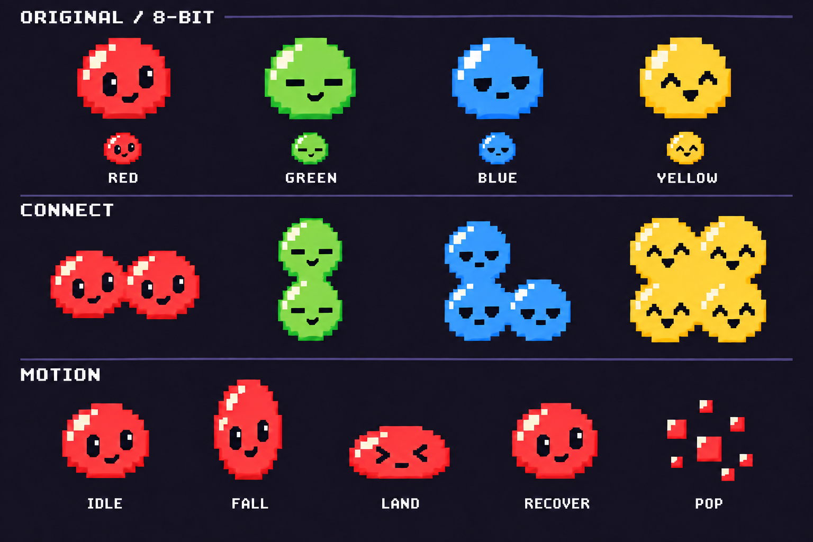

# 015-B：オリジナル8bit風ぷよ素材

更新日：2026-09-26。**利用者が絵柄を承認。015-Bの素材制作と015-Cのゲーム組み込みを分離して管理する。**

利用者の「進めて良い」と、スクリプト加工への「いいよ」を受けて本制作へ進行。
最新の契約は [実装用素材の制作記録](PUYO-PIXEL-PRODUCTION.md)、実施状況は [開発進捗](../progress-report.md) を参照。以下は原案制作時点の記録で、承認前の作業を含む。

## 原案制作時点の進め方

利用者から015-Aの確認後に「確認した次に進んで」と回答があったため、015-Bへ進む。
この回答は次段階への了承として記録し、未特定の実操作項目を個別に成功したとは推定しない。
015-Aの記録は [実操作チェック](../reviews/CHAIN-ANIMATION-CHECK.md)、全体仕様は [連鎖アニメーション設計](CHAIN-ANIMATION-DESIGN.md)。

`astra-sol-development` に従い、設計担当 `pixel_puyo_b_design`（gpt-6-astra / high）が既存コードと設計を確認。
この段階は見た目の選定まで。imagegenで原案を作り、承認後に本番素材制作へ進む。
Solの描画実装・独立コードレビューはまだ起動していない。表示差替え・個別再生は015-Cに分離する。

## 確認する原案

- 上段：赤（縦目）・緑（横目）・青（伏せ目）・黄（山形の目）。色に加えて表情を分ける。
- 中段：横2個、縦2個、L字3個、2×2の4個。胴体をつないでも1セルに1顔を保つ。
- 下段：通常 → 落下の縦伸び → 着地の横つぶれ → 復帰 → 粒化。

利用者の参考スプライトを切り抜き・トレース・色替え流用せず、画像生成の入力にもしていない。
新規生成の後、過剰な発光と連結時の顔の不統一を修正し、緑の顔を赤と区別した。
制作方式は内蔵image_gen。最終画像と [全プロンプト](../../assets/puyo/source/CONCEPT-PROMPTS.md) を保存。

Astraが最終画像を直接確認し、4色、接続時の2/2/3/4個の顔、動きの方向性を確認。
基本の絵柄の承認用として適切と判断した。本番素材の受入ではない。

## 本制作の仕様

| 用途 | 原画 | 表示と配置 |
|---|---|---|
| 盤面・操作中ペア | 24×24px | 48×48px、整数2倍、既存48pxセル |
| NEXT | 12×12px | 36×36px、整数3倍 |
| NEXT 2 | 12×12px | 24×24px、整数2倍、既存26px枠の中心 |
| 教材図 | 8×8px | 16×16px、整数2倍、既存18pxセル |

教材図の16px表示を確認したため、12px版の非整数拡大ではなく専用8px版を用意する。
盤面座標・衝突範囲・パネル寸法・文字描画は変更しない。

- 透明PNG、少数色、補間なし。セル中央原点と足元を揃える。
- 同色の上下左右を4bit（上1・右2・下4・左8）で表す16状態。斜め・別色は接続しない。
- 接続辺は境界まで届かせ、未接続辺には透明余白を残す。顔を独立した要素として1個ずつ維持する。
- フレームは `red/idle`、`red/connect/0..15`、`red/fall/0..1` など、色／状態／番号の命名を使う。
- 接続成立、落下、着地、消滅のコマと時間の対応表を本制作で揃える。時間管理は既存ChainPlaybackに従う。
- 粒は別素材。ツモの乱数・物理・推薦・採点に関与しない。
- 制作データは `assets/puyo/source/`、本番素材は `src/assets/puyo/` に分離。コンセプトを本番アトラスとして読み込まない。

## 原案の限界と次の確認

保存PNGは1536×1024・RGBの不透明な説明用画像。透明な24px原画ではない。
小見本もゲーム内48px表示の検証ではなく、全16マスク、全色の動き、全小サイズを網羅していない。
画素格子・色数・フレーム間の原点は本制作で整える。着地の横広がりは24px枠に収め直す。
プロンプトとPNGは保存したが、レイヤー付き原画や全フレームの再編集データの完成とはみなさない。

「この顔・配色・輪郭・連結・動きの方向性で本制作へ進むか」は利用者承認済み。
全状態とミニ版を制作し、寸法・透明度・欠落・境界・半透明ガイド・実寸の見やすさを検証する。
その後の015-CでSolがアプリへ組み込み、独立Sol3人→Astra確認の工程を行う。

## 原案制作時点の検証と範囲

- 原案の寸法・PNG形式・SHA-256を確認し、Astraと進行担当が画像を目視確認。
- 015-A最終スナップショットのsrc内155ファイルと現在のファイルを照合し、不一致0。
- アプリ・テストコード、設定、ゲーム中の盤面は変更していない。
- 今回はテストを再実行していない。前回の988テスト・型検査・ビルド成功は015-A時点の記録。
- 015-Bは未完了、015-Cは未着手。015-A未特定の実操作確認を新規に完了扱いにしない。

Habitica：015-B `4230bafb-39f5-486e-a924-f3a092bf7973`。親015は継続。
